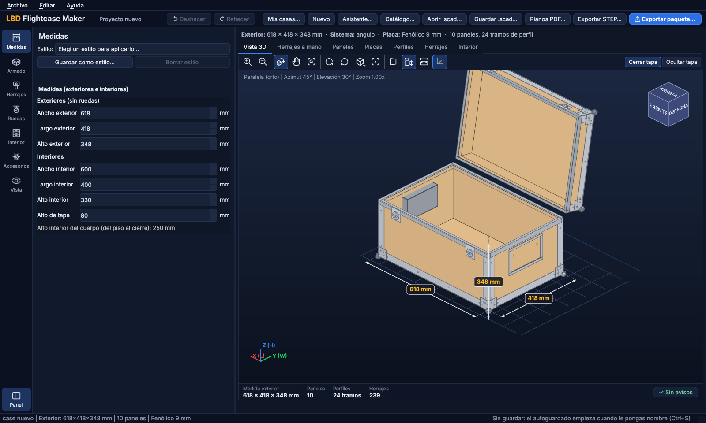
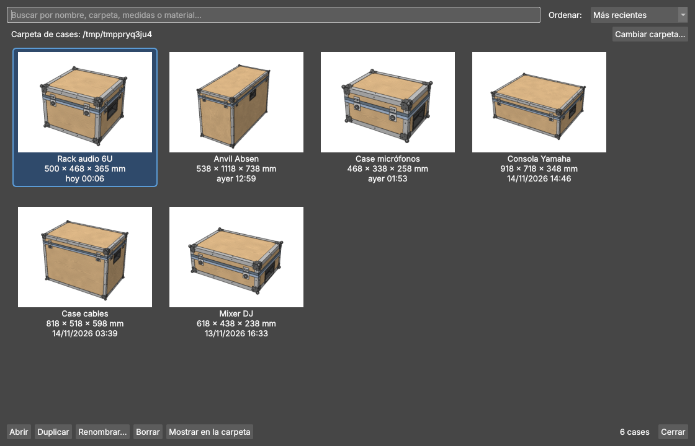
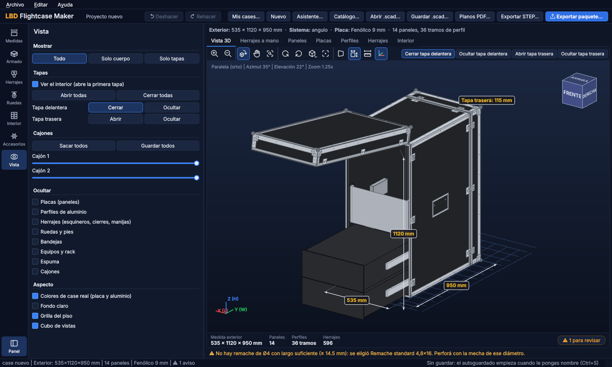
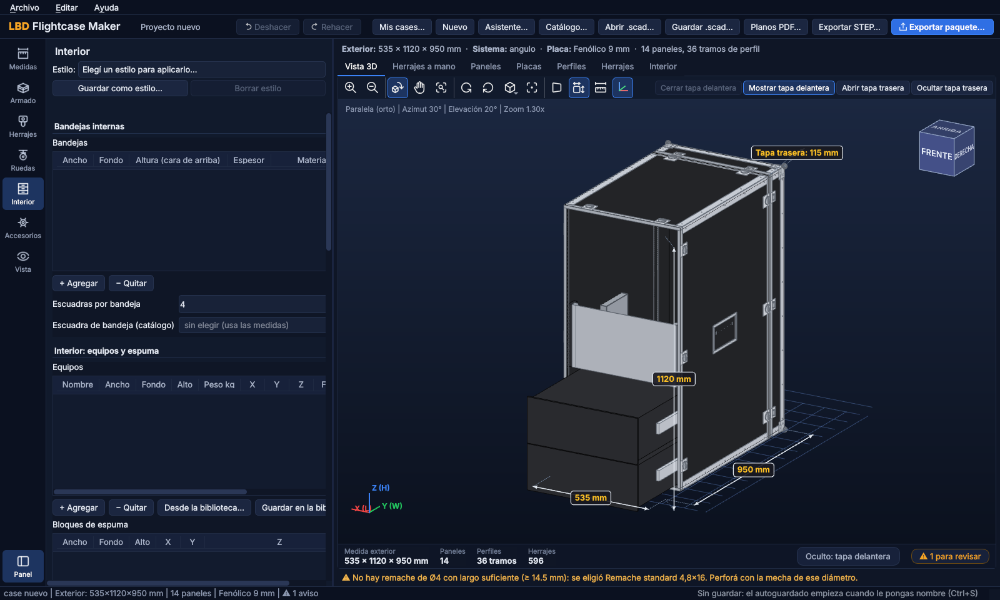
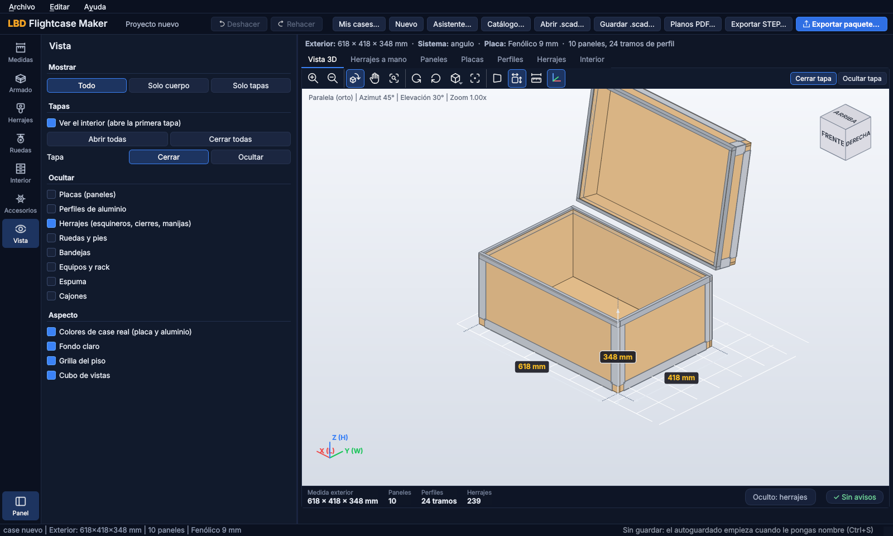
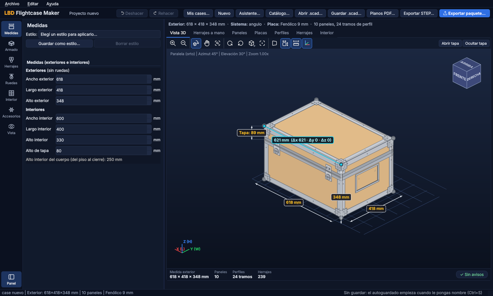

# LBD Flightcase Maker

Programa de escritorio (Python + PySide6 + OpenGL) para diseñar y fabricar flightcases a medida con las reglas de construcción del taller: placa de 10 mm, ángulo 32x32, perfil híbrido, refuerzos, tapas, bandejas, base de ruedas, herrajes del catálogo, interiores con espuma, cajones y rack 19". Lee y guarda los proyectos `.scad` del generador de OpenSCAD y arma el paquete de producción sin tener OpenSCAD instalado.



---

## Funciones

- **Medidas exteriores e interiores enganchadas** (sección Medidas): ancho, largo y alto exterior; ancho, largo y alto interior y alto de tapa. Al cambiar unas se recalculan las otras con las paredes, el aluminio y la espuma del armado elegido; el alto de tapa se mantiene y el cuerpo toma la diferencia.
- **Editor del case**: todos los parámetros del generador, agrupados como en `flightcase.scad`, con su explicación al pasar el mouse. Paneles, perfiles, herrajes y avisos se recalculan al instante.
- **Estilos de case** (rack, mixer, utilitario, tapa superior, cajonera, etc.) y estilos propios guardados.
- **Interiores**: espuma en capas con calados rectangulares, redondos o con el contorno de un dibujo, huecos para los dedos, cajones, rack 19" y chequeos de choques.
- **Ruedas a elección**: giratorias, fijas, con freno o freno total de 75 a 150 mm (2 giratorias con freno + 2 fijas para que el case vaya derecho), **cazoletas** embutidas en el piso que bajan el case, o **base suelta** (wheel board) con marco de ángulo donde se apoya el case sin perforar el piso.
- **Herrajes a mano** en cada cara, en 2D, con imán, y placas de logo desde `.svg` / `.dxf`.
- **Mis cases** (`Ctrl+Shift+O` o el botón **Mis cases…**): tus proyectos guardados con miniatura, nombre, medidas exteriores y fecha. Se buscan por nombre, carpeta, medidas o material, se ordenan por fecha, nombre o tamaño, y se abren, duplican, renombran o mandan a la papelera. Lista los `.scad` de la carpeta de cases (por defecto `Documentos/LBD Flightcase Maker`, con dos niveles de subcarpetas) y los abiertos hace poco. Un case nuevo se guarda ahí por defecto.
- **Autoguardado, recuperación y versiones**: el case abierto se guarda solo cada 3 minutos si tiene cambios (**Archivo → Autoguardado**: 1, 3, 5 o 10 minutos, o desactivado; un case nuevo empieza a autoguardarse cuando le ponés nombre). Cada 30 segundos queda además una copia de recuperación: si la app se cierra de golpe, al volver a abrirla ofrece recuperar los cambios. Cada vez que se guarda, lo que había antes queda como versión fechada en `.versiones/<nombre del case>/` junto al archivo (una cada 10 minutos como mucho; todas las de dos días, una por día hasta los dos meses y una por mes después). **Archivo → Versiones anteriores** (`Ctrl+Alt+V`) o **Versiones…** en Mis cases las lista con medidas y qué cambió, y restaura la elegida en la ventana sin tocar el archivo. Al salir con cambios sin guardar, la app pregunta.
- **Asistente de case nuevo** (`Ctrl+Shift+N` o el botón **Asistente…**): estilo, qué va adentro (vacío, espuma con equipos o rack), medidas sugeridas a partir de los equipos (o exteriores a mano), terminaciones y un resumen antes de abrirlo en el Taller.
- **Biblioteca de equipos** (`Ctrl+B`, menú **Editar**): tus equipos con sus medidas, peso, U de rack y forma del calado, guardados una vez para cualquier case. Se buscan, se editan en la tabla y se pasan a una planilla CSV de Excel y desde ella. Las tablas de equipos de la espuma y del rack tienen **Desde la biblioteca…** y **Guardar en la biblioteca**.
- **Interfaz nueva**: tema oscuro azul, barra lateral de íconos (Medidas, Armado, Herrajes, Ruedas, Interior, Accesorios, Vista) que muestra sólo las secciones de ese grupo, botón **Panel** para esconder el panel y agrandar la vista 3D, y una barra de datos bajo la vista (medida exterior, paneles, perfiles, herrajes y avisos).
- **Vista 3D animada**: las tapas se abren girando sobre su bisagra, se ocultan con un clic, los cajones salen con su deslizador, se puede ver sólo el cuerpo o sólo las tapas y ocultar grupos de piezas (placas, aluminio, herrajes, ruedas, bandejas, equipos, espuma, cajones). Colores de case real, fondo claro y cubo de vistas para cambiar de vista con un clic.
- **Optimización de cortes** (pestaña **Placas**): las piezas acomodadas en placas enteras, cuántas comprar, aprovechamiento, retazo útil y un DXF por placa para la CNC.
- **Paquete de producción** (`Ctrl+P`): DXF por pieza y por capa de espuma, lista de cortes y materiales en CSV, `planos.pdf`, instructivo de montaje y el case en STEP para CAD.

---

## Requisitos

- Python >= 3.14
- Sistemas operativos: Windows, macOS, Linux

### Dependencias principales

- `PySide6`: interfaz de escritorio moderna basada en Qt
- `PyOpenGL`: renderizado 3D acelerado por hardware (alambre y superficies sólidas)
- `numpy`: transformaciones geométricas 3D rápidas con vectores y matrices

Para desarrollo, `pytest` (tests automáticos) está en el grupo `dev`: `uv` lo instala solo, y con pip se instala con `pip install -e . --group dev`.

---

## Primeros pasos

### Instalar en Windows o Mac (sin Python)

Los instaladores se generan solos en GitHub (*Actions → Instaladores*). Para publicar una versión, creá una etiqueta `vX.Y.Z`: aparecen en *Releases*.

- **Windows**: `LBDFlightcaseMaker-X.Y.Z-Windows-Instalador.exe`. Si aparece «Windows protegió su PC», tocá *Más información → Ejecutar de todas formas* (el instalador todavía no está firmado).
- **Mac**: `…-macOS-AppleSilicon.dmg` (M1 o más nuevo) o `…-macOS-Intel.dmg`. Arrastrá la app a Aplicaciones. La primera vez, clic derecho sobre la app → *Abrir* (todavía no está firmada por Apple).

#### Actualizaciones

La app instalada se fija sola en *Releases* al abrirse (unos segundos después, sin trabar nada) y, si hay una versión nueva, la ofrece con sus novedades: **Actualizar ahora**, **Más tarde** u **Omitir esta versión**. También está en **Ayuda → Buscar actualizaciones…** (en Mac, en el menú de la app), y ahí se puede apagar **Buscar actualizaciones al abrir**. Sin internet no avisa nada.

«Actualizar ahora» baja el instalador que corresponde a la computadora, pregunta si guardar el case si tiene cambios, cierra la app, instala la versión nueva y la vuelve a abrir:

- **Windows**: corre el instalador en silencio (se ve solo la barra de progreso). Windows pide permiso de administrador porque la app está en *Archivos de programa*; si se le dice que no, vuelve a abrir la versión de antes. Como el archivo lo baja la propia app, no aparece el aviso de SmartScreen.
- **Mac**: reemplaza la app en la carpeta donde está y la abre. Hace falta usarla desde *Aplicaciones*: si se abrió desde el `.dmg` o desde Descargas, abre el `.dmg` nuevo para arrastrarla a mano. Lo que baja la app no queda en cuarentena, así que Gatekeeper no vuelve a pedir el clic derecho → *Abrir*.

Al correr desde el código no se busca sola (la versión es la de `pyproject.toml`); desde el menú ofrece abrir la página de la versión.

Los estilos de case propios se guardan en tu carpeta de usuario (`%APPDATA%\FlightcaseCalculator` en Windows, `~/Library/Application Support/FlightcaseCalculator` en Mac), así que no se pierden al actualizar.

### 1. Instalación para desarrollo

Cloná o descargá el repositorio e instalá las dependencias:

```bash
# Con uv (recomendado)
uv sync

# O con pip
python -m venv .venv
# Windows:
.venv\Scripts\activate
# Linux / macOS:
source .venv/bin/activate

pip install -e .
```

### 2. Ejecutar la aplicación

- **Acceso directo en Windows**: hacé doble clic en `run.cmd` o ejecutá:
  ```cmd
  run.cmd
  ```
- **Desde la terminal**:
  ```bash
  python main.py
  # o con uv
  uv run python main.py
  ```

### 3. Ejecutar los tests

Para correr todos los tests:

```bash
uv run pytest
# o con el entorno virtual activado (después de pip install -e . --group dev):
pytest
```

En GitHub corren solos en cada PR y en cada cambio a main (`.github/workflows/tests.yml`).

---

## Reglas del taller (proyectos OpenSCAD)

`flightcase/taller/` tiene en Python las reglas de construcción del generador de OpenSCAD del taller (placa de 10 mm, ángulo 32x32, perfil híbrido, refuerzos, tapas, cubiertas, bandejas, base de ruedas, catálogo FR Sistemas / Adam Hall), más los interiores (espuma, cajones, rack 19"). En la ventana del Taller se editan todos los parámetros del generador (agrupados como en `flightcase.scad`, con su explicación al pasar el mouse) y se ven al instante los paneles, perfiles, herrajes y avisos; desde ahí se abre y se guarda el `.scad` y se exporta el paquete. También, con **Archivo → Paquete del taller desde un .scad sin abrirlo** (`Ctrl+T`) se toma un proyecto `.scad` (por ejemplo `mi_case.scad`) y se genera, sin tener OpenSCAD instalado:

- `dxf/*.dxf`: un DXF por pieza distinta, con calados (capa 0), rebajes (capa `REBAJE`) y los agujeros de remaches (`PERFORACIONES`) y tornillos (`TORNILLOS`)
- `dxf/placas/*.dxf`: un DXF por placa entera con las piezas ya acomodadas (ver **Placas** abajo)
- `lista_cortes.csv`, `placas.csv` y `materiales.csv` (separador `;`, se abren directo en Excel)
- `planos.pdf`: piezas acotadas, aprovechamiento de placas, cortes de perfiles y materiales
- `instructivo_montaje.pdf`: perspectiva explotada y pasos de armado con sus láminas 3D (`montaje/*.png`, dibujadas por la app; el aluminio y los herrajes van simplificados)
- `case_3d.step`: el case armado en 3D para abrir en Fusion, SolidWorks o FreeCAD (ver abajo)

### Placas: optimización de cortes

La pestaña **Placas** del Taller acomoda todas las piezas del pedido (todos los cases de **Cantidad de cases**, separadas por material) en placas enteras con el kerf y el margen de **Corte y compra**. Prueba varias formas de acomodarlas y se queda con la que usa menos placas y deja el retazo más grande. Arriba dice cuántas placas comprar, el aprovechamiento y el retazo libre más grande (marcado en verde en el dibujo). **Girar piezas** deja rotarlas 90° para aprovechar mejor; apagalo si la placa tiene veta o dibujo.

**Guardar DXF de las placas…** escribe un DXF por placa con cada pieza en su lugar, lista para la router CNC: borde de la placa en la capa `PLACA`, contornos y calados pasantes en `0`, rebajes en `REBAJE`, marcas de herrajes en `MARCA`, logos en `GRABADO`, agujeros de remaches en `PERFORACIONES`, tornillos en `TORNILLOS` y el número de pieza en `TEXTO` (para apagar en el CAM). También va `placas.csv` con las piezas de cada placa. Lo mismo sale en el paquete de producción.

**Perforaciones.** Los agujeros de remaches salen como círculos con el diámetro de la mecha (remache + 0,1 mm) en la capa `PERFORACIONES`, para taladrarlos en la CNC o apagarlos si se perforan a mano: las filas de los ángulos de las aristas (en el medio del ala) y de los aros de cierre, con la misma cantidad que la lista de materiales (`remache_paso`); las patas de los esquineros; y alrededor de cierres, bisagras (también la de piano), manijas, cazoletas, platos y placas de logo, incluidos los herrajes puestos a mano. Los remaches del perfil que tapa un herraje no se perforan. Los tornillos del marco de la base suelta van en `TORNILLOS`; los bulones de las ruedas siguen en la capa 0. Si un artículo del catálogo trae `perforaciones` (`[[dx, dy], ...]` en mm desde el centro del herraje; en cierres y bisagras `dy` se mide desde la línea de cierre, negativo del lado del cuerpo), se usan esas posiciones en lugar de las estimadas.

### Mis cases



Las miniaturas se dibujan con la misma vista 3D del instructivo y quedan guardadas en la carpeta de datos de la app; solo se vuelven a dibujar cuando cambia el `.scad`. **Duplicar** copia el case en la misma carpeta (los logos y contornos con ruta relativa siguen funcionando), ideal para hacer una variante. Si renombrás o borrás el case que tenés abierto, la ventana lo sigue: con el nombre nuevo, o como case sin guardar.

### Atajos del Taller

- `Ctrl+Shift+O` **Mis cases** (dentro: `Ctrl+F` buscar, `F2` renombrar, `Ctrl+D` duplicar, `Supr` borrar, doble clic abre)
- `Ctrl+Alt+V` **Versiones anteriores** del case abierto
- `Ctrl+N` nuevo case, `Ctrl+O` abrir `.scad`, `Ctrl+S` guardar (sin preguntar si ya tiene archivo), `Ctrl+Shift+S` guardar como
- `Ctrl+Shift+N` case nuevo con el asistente, `Ctrl+B` biblioteca de equipos
- `Ctrl+P` exportar el paquete del taller (planos, DXF, instructivo)
- `Ctrl+Shift+P` (o el botón **Planos PDF…**) guarda sólo `planos.pdf`, igual que el que armaba el generador de OpenSCAD: resumen con el render en el color de la placa, perspectiva explotada, perfil de cierre, detalle de la junta, cubierta removible, cada pieza acotada, placas, perfiles y materiales
- `Ctrl+Z` deshacer y `Ctrl+Y` (o `Ctrl+Shift+Z`) rehacer cualquier cambio del case: medidas, armado, estilo, herrajes a mano, interior. El menú **Editar** dice qué se va a deshacer; el historial guarda los últimos 200 pasos y empieza de cero al abrir otro proyecto
- Al abrir la app se vuelve a cargar el último `.scad` que usaste, y la barra de estado muestra medidas, paneles, material y avisos del case

### Vista 3D



El botón **Vista** de la barra lateral abre el panel de la vista:

- **Mostrar**: todo el case, sólo el cuerpo o sólo las tapas.
- **Tapas**: cada tapa con **Abrir** (gira sobre su bisagra, con animación) y **Ocultar**. La tapa de arriba de un case parado abre hacia atrás; la delantera de un rack frontal sube como un alero. Los mismos botones están arriba a la derecha de la vista 3D. **Ver el interior** abre la primera tapa (se marca solo al cargar el primer interior).
- **Cajones**: un deslizador por cajón para sacarlo con su corredera, y **Sacar todos** / **Guardar todos**.
- **Ocultar**: placas, perfiles de aluminio, herrajes, ruedas y pies, bandejas, equipos y rack, espuma y cajones. Lo que está oculto aparece abajo, en la barra de datos.
- **Aspecto**: colores de case real (placa del color del proyecto, negra si es negra, aluminio y herrajes cromados) o los colores técnicos de antes, fondo claro, grilla del piso y cubo de vistas.





**Acotar y medir**:

- **Cotas** (botón con la cota ↔): ancho, fondo y alto por fuera del case (sin ruedas) y el alto de cada tapa cerrada, dibujadas al costado del case.
- **Medir** (botón de la regla): clic en dos puntos del case y muestra la distancia y cuánto cambia en X, Y y Z. El punto se engancha a la esquina o vértice más cercano al mouse (se marca en celeste antes de hacer clic). Un tercer clic empieza otra medida; `Esc` la borra.



El **cubo de vistas** (arriba a la derecha) gira con el case y cada cara lleva su nombre pegado en perspectiva (FRENTE, DERECHA, ARRIBA…). Un clic en una cara cambia a esa vista.

La barra de arriba de la vista tiene: acercar y alejar, qué hace el botón izquierdo del mouse (girar alrededor del case, **mano** para mover la imagen, o zoom arrastrando hacia arriba y abajo), girar 90°, vistas (isométrica, frente, atrás, lados, arriba, abajo), encuadrar, perspectiva, cotas, medir y ejes. Los íconos son del set [Tabler Icons](https://tabler.io/icons) (licencia MIT, en `flightcase/resources/iconos`). Además:

- Rueda del mouse: zoom hacia donde está el puntero. Botón derecho o rueda apretada: mover. Doble clic: encuadrar.
- Teclado (con la vista seleccionada): flechas giran de a 5°, Mayús + flechas mueven, `+` y `-` hacen zoom, `Inicio` o `F` encuadran.

### Ícono de la app

Sale de `packaging/icono/icono.svg`. Si lo cambiás, regenerá el `.ico` (Windows), el `.icns` (Mac) y el `.png` de la ventana con `python tools/generar_icono.py`.

### Estilos de case y herrajes del catálogo

Arriba de la pestaña Taller, **Estilo de case** aplica una forma de armado sobre las medidas que ya cargaste, sin tocar el interior ni los herrajes puestos a mano: baúl con tapa suelta, con tapa abisagrada o con base de ruedas, case de mano con pies, clamshell de dos mitades, bisagra de piano, tapa arriba y abajo, racks 19" (tapa adelante, adelante y atrás, con tapas de acceso o con cubierta que sale entera), case acostado con tapas a los costados y case liviano con perfil híbrido. Los estilos con base de ruedas la calculan solos (10 mm más chica que la planta del cuerpo, fenólico de 18 mm). Con **Guardar como estilo…** guardás cómo está armado tu case (todo menos medidas e interior) para usarlo en otros proyectos; los estilos propios van a tu carpeta de datos y aparecen con ★.

En **Herrajes del catálogo FR Sistemas** cada herraje (placa, ángulo, perfiles de cierre, esquineros, cierres, manijas, ruedas, bisagras, topes, pies, espuma, remaches…) se elige de una lista con número y nombre, filtrada por tipo; se puede escribir parte del nombre para buscar. Los artículos con * tienen medidas estimadas. En **Otros accesorios → extras** se agregan, en una tabla, artículos del catálogo para la lista de compras (asas telescópicas, argollas, tornillería, carátulas de rack…) con su cantidad.

### Exportar a STEP

Con el botón **Exportar STEP…** del Taller (o **Archivo → Exportar a STEP**, `Ctrl+Alt+S`) se guarda el case armado, con las tapas cerradas, como un ensamble STEP (AP214, en milímetros). Cada pieza es un sólido de caras planas con su nombre y su color: los paneles con sus calados pasantes, los aros y ángulos de aluminio, los esquineros, cierres, manijas y ruedas (simplificados, igual que en la vista 3D) y el interior (equipos, espuma con sus bolsillos, cajones y rack). El archivo lo escribe la app directamente, sin librerías de CAD; los tests lo validan con OpenCASCADE (el motor de FreeCAD) cuando está instalado.

### Interiores

En las secciones **Interior** de la pestaña Taller se carga lo que va adentro, en tablas (las medidas en mm, desde el costado izquierdo, el frente del cuerpo y el piso interior):

- **Equipos**: medidas, peso y posición de cada cosa que va en el case.
- **Espuma**: bloques que se cortan en capas del espesor de la plancha; cada equipo que cae en un bloque lleva su calado (con holgura) desde la cara abierta hasta el fondo del equipo. Si el fondo cae dentro de una capa, esa capa lleva un rebaje. Sale un DXF por capa (`dxf/espuma/`) y `espuma.csv`; la espuma de la tapa abre hacia el cuerpo.
- **Forma de cada calado** (columnas *Forma en la espuma*, *Radio* y *Dedos* de la tabla de equipos): rectángulo, **redondo** (micrófonos, tachos, focos) o el **contorno de un dibujo** `.dxf` / `.svg` del equipo, que se encaja en su ancho y fondo. Las esquinas se redondean con el radio de la fresa (`espuma_radio`, o uno por equipo) y se pueden agregar **huecos para los dedos** en uno o los dos lados largos (`espuma_dedo_ancho`, `espuma_dedo_largo`). Los calados con forma salen en el DXF de cada capa como polilíneas cerradas (en la capa 0 si son pasantes, en REBAJE si no), en los planos con su dibujo y en la vista 3D y el STEP en escalones; el peso de la espuma descuenta el área real.
- **Cajones** (cases frontales): frente, laterales, trasera y piso con correderas telescópicas (12,7 mm por lado; la corredera más larga que entra si no se indica). Las piezas pasan a la lista de cortes, los DXF y las placas.
- **Forro por cara** (sección *Interior: forro por cara*): alfombra o espuma pegada adentro, eligiendo cara por cara (piso, frente, trasera, laterales) o un grupo entero; la tapa va aparte (su cara y sus paredes). Las medidas interiores siguen siendo el espacio útil y el case crece lo que mide el forro de cada cara. Las piezas se cortan para armarse así: el piso a todo el interior, frente y trasera a todo el ancho y los laterales entre ellos (en la tapa, el techo entero y las paredes debajo), con los huecos de manijas, cierres embutidos, cazoletas y platos. Salen en la lista de cortes, en DXF (vistas desde adentro), acomodadas en planchas de espuma o trozos de rollo de alfombra (`forro_espuma_plancha`, `forro_alfombra_plancha`), en la compra con el adhesivo, en la vista 3D y el STEP, y con su paso en el instructivo.
- **Rack 19"** (frontal: rieles verticales; vertical: rack de tapa superior): rieles, suplementos si el interior es más ancho, equipos por U, carátulas ciegas para las unidades libres, tuercas enjauladas y tornillos.
- **Chequeos**: piezas que se salen del interior o del cuerpo, choques entre equipos, bandejas, cajones, rieles y espuma, fondo del rack con lugar para cables, perillas contra la tapa, equipos pesados sin soporte trasero, paredes y fondo mínimos de la espuma.

En el paquete, `planos.pdf` suma hojas del interior (vista 3D con las tapas abiertas, la espuma capa por capa con calados y rebajes, el rack de frente con sus U y los frentes de los cajones) y el instructivo suma los pasos de montaje del rack, cada cajón y la espuma.

La pestaña **Interior** resume el espacio útil y el peso, y en la **Vista 3D** la casilla *Ver el interior* abre las tapas. Los parámetros se guardan en el mismo `.scad` (OpenSCAD los ignora).

### Herrajes a mano

La pestaña **Herrajes a mano** muestra cada cara del case en 2D, vista desde afuera y derecha (como queda parado en uso), con los paneles, el aluminio (ángulos, perfiles de cierre, esquineros), la junta de cierre de la tapa y los herrajes automáticos en gris. Ahí se agregan herrajes del catálogo (manijas, cierres, bisagras, topes, pies, ruedas, platos, extras), piezas propias con nombre y medida, y **placas de logo** a partir de un dibujo `.svg` o `.dxf` (remachadas o grabadas). Cada herraje se arrastra con el mouse o se ubica exacto con X/Y (centro, desde el borde izquierdo y desde abajo); se gira, se voltea, se copia, se espeja a la cara opuesta o se reemplaza por otro del catálogo. Al arrastrar, el imán lo pega a la junta de cierre, al borde del aluminio, a los ejes de la cara y a los otros herrajes (Alt lo suelta); las flechas lo mueven de a 1 mm (Mayús: 10 mm). Los cierres y bisagras se centran solos sobre la junta y se marcan en el cuerpo y en la tapa.

Lo que se pone a mano sale en los calados de los paneles y sus DXF (marcas en la capa `MARCA`, logos grabados en `GRABADO`), la lista de herrajes y materiales (con sus remaches), la vista 3D, `planos.pdf` (en azul, con el centro acotado) y un paso del instructivo. Se guarda en el `.scad` como `herrajes_manuales = [[ref, cara, x, y, giro, espejo, ancho, alto, archivo, modo], ...]`; la app avisa si un herraje pisa el aluminio, se sale del panel o choca con otro calado.

Los tests comparan el resultado con OpenSCAD: los datos de 18 proyectos y variantes (`tests/golden/taller`) y las listas y DXF de 3 proyectos (`tests/golden/taller_paquete`). Para regenerarlos: `python tools/generar_golden.py ruta/a/flightcase-generador`.
